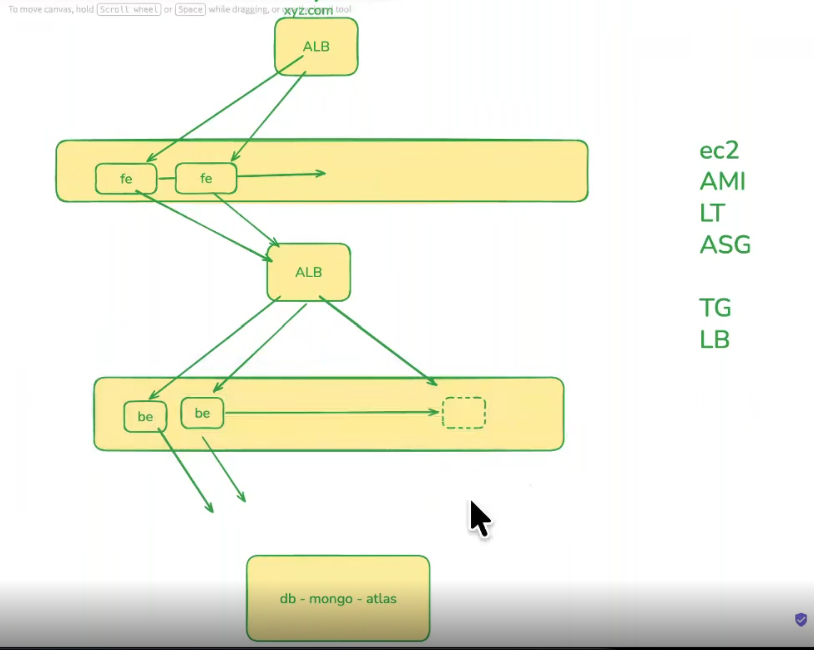
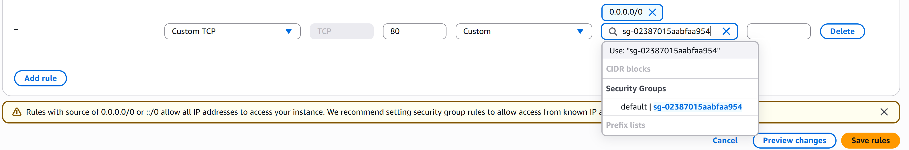

#Diagram for aws setup

#Install package and run backend and frontend apps in your machine 
    apt update
    npm in
    npm start
#Docker hub
    Create account and repository docker hub (https://hub.docker.com/repositories/amadou11)
    Create token (https://app.docker.com/accounts/amadou11/settings/personal-access-tokens)
    login with you VM(ubuntu)

#Backend
    db: make sure your backend is connected with db(go backend->app.js)
    Dockerfile: Create your dockerfile
    Creat image: docker build -t amadou11/goals-backend:v1.0 .
    Push image to repos: docker push amadou11/goals-backend:v1.0

#Frontend
    backend_url: make sure your frontend is connected to backend(go frontend->src->app.js and replcace backend url to old)
    Dockerfile: Create your dockerfile
    Creat image: docker build -t amadou11/goals-backend:v1.0 .
    Push image to repos: docker push amadou11/goals-backend:v1.0
#AWS
    Launch instance template
        install docker (https://docs.docker.com/engine/install/ubuntu/)
        run image from docker repos: docker run -p 5000:5000 amadou11/goals-backend:v1.0 /
                                     docker run -p 80:80 amadou11/goals-frontend:v1.0
    #backend:
    Create AMI from your instance template
    Launch template (if you make some update from your code make to follown all preview process and here you have to update template and version)
    Create Target Group (port used 5000)
    Load balance (port used 5000)
    Auto Scaling Group
    CloudWatch (alarm cpu utilisation)
        ASG(automatic scaling)
    #frontend:
    Create AMI from your instance template
    Launch template (if you make some update from your code make to follown all preview process and here you have to update template and version)
    Create Target Group (port used 80)
    Load balance (port used 80)
    Auto Scaling Group
    CloudWatch (alarm cpu utilisation)
        ASG(automatic scaling)
    
    Security Group: use backend sg to target frontend security group without exposing backend resources, like image below
                